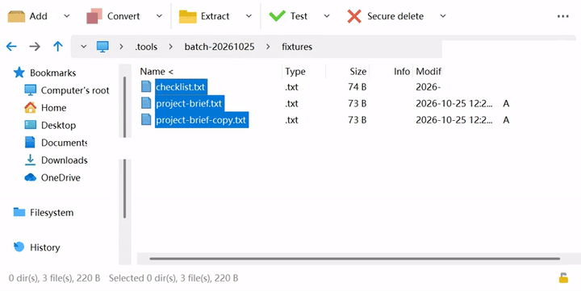
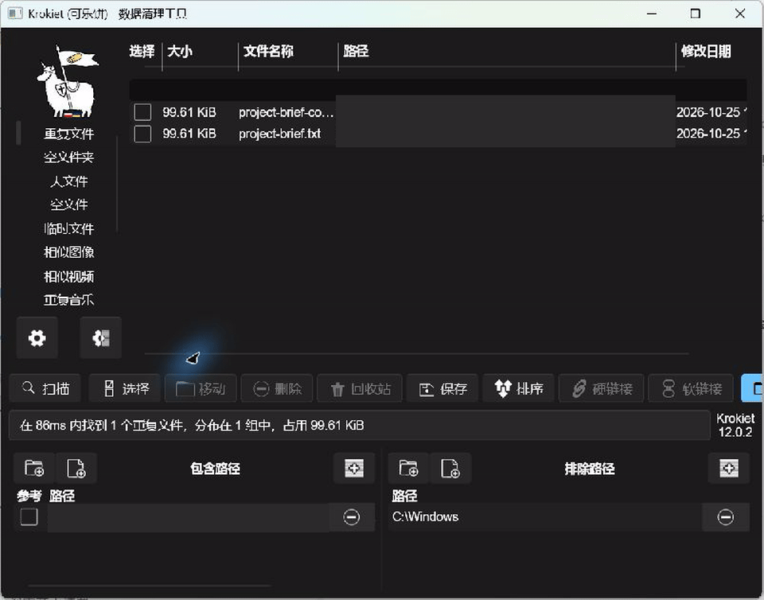
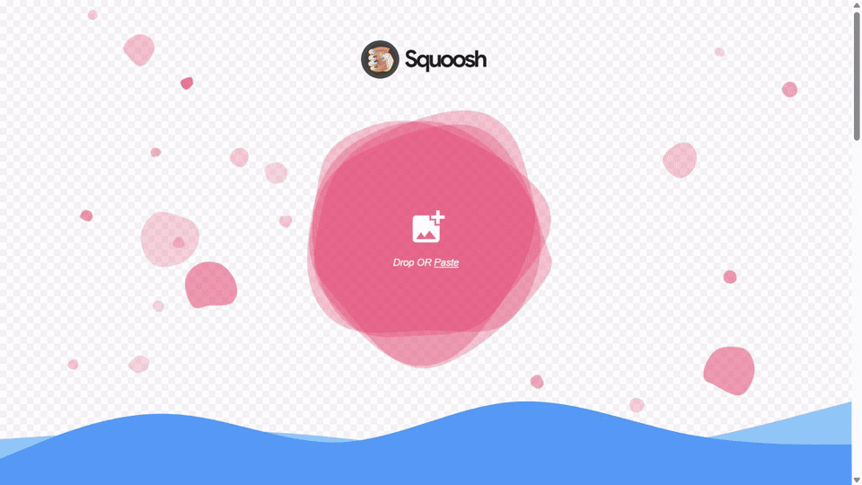

# everything_ok

[简体中文](README.md) · [Video gallery](https://dogchenya.github.io/everything_ok/)

Useful GitHub tools, grouped by purpose, with descriptions, setup requirements and GIF demos.

[Share and organize files](#file-sharing) · [Documents and productivity](#office) · [Images, recording and video](#media-tools) · [AI and local models](#ai-tools) · [Development and automation](#developer-tools) · [Photo management](#photos)

## Share and organize files

<table>
<thead><tr><th>Tool</th><th>Purpose and setup</th><th>GIF demo</th></tr></thead>
<tbody>
<tr>
<td width="120" valign="top"><strong><a href="https://github.com/localsend/localsend">LocalSend</a></strong> ★ 95,358</td>
<td width="260" valign="top"><strong>Share files across nearby devices</strong>  Setup：Install on devices that can reach each other

Demo scope
Accept a file → receive it successfully. Sent by a protocol test client on the same computer; two physical devices are not demonstrated.
</td>
<td width="420" valign="top"> <a href="https://dogchenya.github.io/everything_ok/media/localsend-demo.mp4">MP4 video</a> · 2× · 12.5 s</td>
</tr>
<tr>
<td width="120" valign="top"><strong><a href="https://github.com/schlagmichdoch/PairDrop">PairDrop</a></strong> ★ 11,663</td>
<td width="260" valign="top"><strong>Transfer files between browsers</strong>  Setup：Use the hosted app; self-hosting needs a server

Demo scope
Demo provided by the upstream project.
</td>
<td width="420" valign="top"> <a href="https://github.com/schlagmichdoch/PairDrop/blob/master/docs/pairdrop_screenshot_mobile.gif">Upstream GIF</a></td>
</tr>
<tr>
<td width="120" valign="top"><strong><a href="https://github.com/dogchenya/GatherPack">GatherPack</a></strong> ★ 0 Own project</td>
<td width="260" valign="top"><strong>Collect scattered files and archive them together</strong>  Setup：Desktop installation; Alpha, with platform validation limits

Demo scope
Collect files from two folders → inspect the collection → create a ZIP; two files written, no failures.
</td>
<td width="420" valign="top"> <a href="https://dogchenya.github.io/everything_ok/media/gatherpack-demo.mp4">MP4 video</a> · 2× · 25.5 s</td>
</tr>
<tr>
<td width="120" valign="top"><strong><a href="https://github.com/syncthing/syncthing">Syncthing</a></strong> ★ 89,671</td>
<td width="260" valign="top"><strong>Keep folders synchronized across your devices</strong>  Setup：Install and pair devices, then choose synchronized folders

Demo scope
Two isolated local instances: write a file → synchronize → verify the received content.
</td>
<td width="420" valign="top"> <a href="https://dogchenya.github.io/everything_ok/media/syncthing-demo.mp4">MP4 video</a> · 2× · 15.1 s</td>
</tr>
<tr>
<td width="120" valign="top"><strong><a href="https://github.com/files-community/Files">Files</a></strong> ★ 46,178</td>
<td width="260" valign="top"><strong>A Windows file manager with tabs, dual panes and column view</strong>  Setup：Install on Windows; paid Store distribution and a website installer

Demo scope
Official column-view GIF. Dual panes, archive editing and a local installation are not demonstrated.
</td>
<td width="420" valign="top"> <a href="https://raw.githubusercontent.com/files-community/Website/main/static/blog-resources/v4/Columns.gif">Upstream GIF</a></td>
</tr>
<tr>
<td width="120" valign="top"><strong><a href="https://github.com/peazip/PeaZip">PeaZip</a></strong> ★ 8,015</td>
<td width="260" valign="top"><strong>Create, extract and inspect archives in common formats</strong>  Setup：Windows, macOS and Linux; free portable builds available; some formats are extraction-only

Demo scope
Recorded: three synthetic text files packed into ZIP; entries and CRC verified. Extraction, encryption and RAR workflows are not recorded.
</td>
<td width="420" valign="top"> <a href="https://dogchenya.github.io/everything_ok/media/peazip-demo.mp4">MP4 video</a> · 2× · 12.2 s</td>
</tr>
<tr>
<td width="120" valign="top"><strong><a href="https://github.com/qarmin/czkawka">Czkawka / Krokiet</a></strong> ★ 34,514</td>
<td width="260" valign="top"><strong>Find duplicate files and similar images to help organize storage</strong>  Setup：Windows, macOS and Linux; available interfaces and dependencies vary by build  <strong>Step GIF</strong>

Demo scope
Tested step GIF shows one group of duplicate synthetic files. No files deleted; not continuous video.
</td>
<td width="420" valign="top"> Step GIF</td>
</tr>
</tbody>
</table>

## Documents and productivity

<table>
<thead><tr><th>Tool</th><th>Purpose and setup</th><th>GIF demo</th></tr></thead>
<tbody>
<tr>
<td width="120" valign="top"><strong><a href="https://github.com/Stirling-Tools/Stirling-PDF">Stirling PDF</a></strong> ★ 94,822</td>
<td width="260" valign="top"><strong>Merge, split, convert and process PDFs</strong>  Setup：Desktop or self-hosted; distinguish community features and paid plans. Some Office conversions require cloud or server support; check each format.

Demo scope
Import two PDFs → merge → inspect pages → download; page count and order verified.
</td>
<td width="420" valign="top"> <a href="https://dogchenya.github.io/everything_ok/media/stirling-pdf-demo.mp4">MP4 video</a> · 2× · 16.3 s</td>
</tr>
<tr>
<td width="120" valign="top"><strong><a href="https://github.com/excalidraw/excalidraw">Excalidraw</a></strong> ★ 134,441</td>
<td width="260" valign="top"><strong>Sketch diagrams and explain ideas on a hand-drawn whiteboard</strong>  Setup：Open the web app; paid collaboration offerings are separate  <strong>Partial · export unverified</strong>

Demo scope
Draw a bilingual diagram → open export preview. File saving remains unverified; this is a partial workflow.
</td>
<td width="420" valign="top"> <a href="https://dogchenya.github.io/everything_ok/media/excalidraw-demo.mp4">MP4 video</a> · 2× · 14.2 s</td>
</tr>
<tr>
<td width="120" valign="top"><strong><a href="https://github.com/microsoft/PowerToys">PowerToys</a></strong> ★ 139,688</td>
<td width="260" valign="top"><strong>Productivity utilities for Windows</strong>  Setup：Windows; install and enable selected utilities

Demo scope
Demo provided by the upstream project.
</td>
<td width="420" valign="top"><a href="https://raw.githubusercontent.com/microsoft/PowerToys/main/src/settings-ui/Settings.UI/Assets/Settings/Modules/OOBE/FancyZones.mp4">▶ Upstream demo video</a></td>
</tr>
<tr>
<td width="120" valign="top"><strong><a href="https://github.com/Flow-Launcher/Flow.Launcher">Flow Launcher</a></strong> ★ 15,855</td>
<td width="260" valign="top"><strong>Find files and launch apps quickly</strong>  Setup：Windows desktop installation

Demo scope
Demo provided by the upstream project.
</td>
<td width="420" valign="top"> <a href="https://user-images.githubusercontent.com/6903107/207167068-2196d2a3-2caa-4856-958b-a780fbda95c6.gif">Upstream GIF</a></td>
</tr>
<tr>
<td width="120" valign="top"><strong><a href="https://github.com/laurent22/joplin">Joplin</a></strong> ★ 56,852</td>
<td width="260" valign="top"><strong>Take offline notes, manage to-dos and organize information</strong>  Setup：Desktop/mobile installation; choose a sync backend; Joplin Cloud is paid

Demo scope
Official clip shows editing an existing drawing inside a note; note creation, importing and synchronization are not tested.
</td>
<td width="420" valign="top"> <a href="https://raw.githubusercontent.com/laurent22/joplin/dev/Assets/WebsiteAssets/images/draw/edit-existing-drawing-on-desktop.mp4">Upstream video</a> · 8.3 s</td>
</tr>
<tr>
<td width="120" valign="top"><strong><a href="https://github.com/siyuan-note/siyuan">思源笔记 / SiYuan</a></strong> ★ 46,905</td>
<td width="260" valign="top"><strong>Local-first Markdown notes with block references</strong>  Setup：Desktop installation; synchronization and some services are paid

Demo scope
Official guide clip demonstrates list formatting only; block references, sync and AI are not demonstrated or locally tested.
</td>
<td width="420" valign="top"> <a href="https://raw.githubusercontent.com/siyuan-note/siyuan/master/app/guide/20210808180117-6v0mkxr/assets/formatting_elements-20210607225733-o1keasx.mp4">Upstream video</a> · 9.6 s</td>
</tr>
<tr>
<td width="120" valign="top"><strong><a href="https://github.com/hiroi-sora/Umi-OCR">Umi-OCR</a></strong> ★ 48,143</td>
<td width="260" valign="top"><strong>Extract copyable text from screenshots and scanned images, offline and in batches</strong>  Setup：Portable Windows app; Linux version available. Tested image OCR on Windows Rapid v2.1.5 only

Demo scope
Import an image → run offline OCR → inspect text. Date, ID and amount verified; some lines merged. Printed image text only.
</td>
<td width="420" valign="top"> <a href="https://dogchenya.github.io/everything_ok/media/umi-ocr-demo.mp4">MP4 video</a> · 2× · 12.7 s</td>
</tr>
<tr>
<td width="120" valign="top"><strong><a href="https://github.com/PDFMathTranslate/PDFMathTranslate">PDFMathTranslate</a></strong> ★ 37,812</td>
<td width="260" valign="top"><strong>Translate PDFs while preserving formulas, figures and layout where possible</strong>  Setup：Hosted services are linked by the project; local installation available. Some translation providers require API keys or payment; data handling depends on deployment and provider

Demo scope
Official older GUI: import PDF → translate → inspect Chinese output and bilingual download links. Not tested this round; current UI may differ.
</td>
<td width="420" valign="top"> <a href="https://raw.githubusercontent.com/PDFMathTranslate/PDFMathTranslate/main/docs/images/gui.gif">Upstream GIF</a></td>
</tr>
<tr>
<td width="120" valign="top"><strong><a href="https://github.com/super-productivity/super-productivity">Super Productivity</a></strong> ★ 23,123</td>
<td width="260" valign="top"><strong>Plan tasks, schedule time blocks and track focused work</strong>  Setup：Web or desktop app; external calendar and issue tracker integrations require setup

Demo scope
Official reel: task entry and scheduling. External integrations and synchronization are not tested.
</td>
<td width="420" valign="top"> <a href="https://raw.githubusercontent.com/super-productivity/super-productivity/master/docs/screens/reel.gif">Upstream GIF</a></td>
</tr>
<tr>
<td width="120" valign="top"><strong><a href="https://github.com/zotero/zotero">Zotero</a></strong> ★ 15,741</td>
<td width="260" valign="top"><strong>Collect research, annotate PDFs and generate citations and bibliographies</strong>  Setup：Desktop installation; web capture uses Zotero Connector; attachment storage beyond the free quota may require payment

Demo scope
Third-party Grad Coach tutorial covers importing, organizing and citing. UI may be older than the current version; YouTube access required.
</td>
<td width="420" valign="top"> <a href="https://www.youtube.com/watch?v=tnbwKj6-pD8">▶ Third-party tutorial</a> · Grad Coach YouTube access required</td>
</tr>
<tr>
<td width="120" valign="top"><strong><a href="https://github.com/docusealco/docuseal">DocuSeal</a></strong> ★ 18,787</td>
<td width="260" valign="top"><strong>Add fillable fields to PDFs and collect completed forms and signatures online</strong>  Setup：Hosted service or self-hosting; community and Pro features and pricing differ

Demo scope
Official video: PDF templates, fields, recipients and signing. Not tested locally in this round.
</td>
<td width="420" valign="top"> <a href="https://www.docuseal.com/demo.mp4">▶ Official video</a></td>
</tr>
<tr>
<td width="120" valign="top"><strong><a href="https://github.com/OpenRefine/OpenRefine">OpenRefine</a></strong> ★ 12,069</td>
<td width="260" valign="top"><strong>Clean whitespace, formats and inconsistent values in tabular data</strong>  Setup：Runs locally through a browser; some learning required; follow the release package Java requirements

Demo scope
Classic Google Refine 2.0 tutorial linked by the official resources page. Very old UI; current version not tested locally.
</td>
<td width="420" valign="top"> <a href="https://www.youtube.com/watch?v=B70J_H_zAWM">▶ Classic tutorial</a> · GoogleRefine YouTube access required</td>
</tr>
<tr>
<td width="120" valign="top"><strong><a href="https://github.com/paperless-ngx/paperless-ngx">Paperless-ngx</a></strong> ★ 47,071</td>
<td width="260" valign="top"><strong>Organize receipts and scanned documents into a searchable archive</strong>  Setup：Requires a server or NAS, commonly Docker Compose; deployment and backups require technical setup

Demo scope
Third-party Techno Tim setup tutorial; AI is optional. Not deployed locally this round; YouTube access required.
</td>
<td width="420" valign="top"> <a href="https://www.youtube.com/watch?v=NMAwHjleqHg">▶ Third-party tutorial</a> · Techno Tim YouTube access required</td>
</tr>
<tr>
<td width="120" valign="top"><strong><a href="https://github.com/CopyTranslator/CopyTranslator">CopyTranslator</a></strong> ★ 18,122</td>
<td width="260" valign="top"><strong>Translate copied text without repeatedly pasting it into a translation website</strong>  Setup：Desktop app; online providers need networking and may require API keys or payment; local model options need setup

Demo scope
Early GIF linked by the project README shows copied text and a translation. Current v12 and providers are not tested.
</td>
<td width="420" valign="top"> <a href="https://s1.ax1x.com/2018/11/30/FmrNFS.gif">Upstream GIF</a></td>
</tr>
<tr>
<td width="120" valign="top"><strong><a href="https://github.com/nocodb/nocodb">NocoDB</a></strong> ★ 65,351</td>
<td width="260" valign="top"><strong>Manage team data with grids, boards and forms</strong>  Setup：Hosted plans or self-hosting; Sustainable Use License, not a permissive open-source license; review terms for commercial integration

Demo scope
Official README GIF shows grouped grids, galleries and boards. Permissions and importing are not tested.
</td>
<td width="420" valign="top"> <a href="https://github.com/nocodb/nocodb/assets/86527202/e2fad786-f211-4dcb-9bd3-aaece83a6783">Upstream GIF</a></td>
</tr>
</tbody>
</table>

## Images, recording and video

<table>
<thead><tr><th>Tool</th><th>Purpose and setup</th><th>GIF demo</th></tr></thead>
<tbody>
<tr>
<td width="120" valign="top"><strong><a href="https://github.com/mifi/lossless-cut">LosslessCut</a></strong> ★ 45,112</td>
<td width="260" valign="top"><strong>Trim audio and video without re-encoding</strong>  Setup：Desktop installation; learn ranges and format limitations

Demo scope
Import a video → select a segment → export without video re-encoding. Keyframe cuts can shift segment boundaries.
</td>
<td width="420" valign="top"> <a href="https://dogchenya.github.io/everything_ok/media/losslesscut-demo.mp4">MP4 video</a> · 2× · 20.5 s</td>
</tr>
<tr>
<td width="120" valign="top"><strong><a href="https://github.com/NickeManarin/ScreenToGif">ScreenToGif</a></strong> ★ 27,841</td>
<td width="260" valign="top"><strong>Record and edit screen GIFs</strong>  Setup：Windows; check .NET runtime requirements

Demo scope
Demo provided by the upstream project.
</td>
<td width="420" valign="top"> <a href="https://nickemanarin.github.io/ScreenToGif-Website/media/Editor.gif">Upstream GIF</a></td>
</tr>
<tr>
<td width="120" valign="top"><strong><a href="https://github.com/obsproject/obs-studio">OBS Studio</a></strong> ★ 77,992</td>
<td width="260" valign="top"><strong>Record tutorials, stream and compose multiple sources</strong>  Setup：Desktop installation; configure video and audio sources

Demo scope
Add a media source → fit to canvas → start and stop recording → save the video.
</td>
<td width="420" valign="top"> <a href="https://dogchenya.github.io/everything_ok/media/obs-studio-demo.mp4">MP4 video</a> · 3× · 21.1 s</td>
</tr>
<tr>
<td width="120" valign="top"><strong><a href="https://github.com/upscayl/upscayl">Upscayl</a></strong> ★ 50,922</td>
<td width="260" valign="top"><strong>Upscale images with AI</strong>  Setup：Desktop installation; requires compatible graphics hardware

Demo scope
Demo provided by the upstream project.
</td>
<td width="420" valign="top"><a href="https://raw.githubusercontent.com/upscayl/upscayl/main/upscayl.mp4">▶ Upstream demo video</a></td>
</tr>
<tr>
<td width="120" valign="top"><strong><a href="https://github.com/GoogleChromeLabs/squoosh">Squoosh</a></strong> ★ 26,057</td>
<td width="260" valign="top"><strong>Compress images in a browser and compare quality and file size</strong>  Setup：Browser app; images are compressed locally; the site includes analytics  <strong>Step GIF</strong>

Demo scope
Tested step GIF: official sample compressed from 2.79 MB to 862 kB. Downloading is unverified.
</td>
<td width="420" valign="top"> Step GIF</td>
</tr>
<tr>
<td width="120" valign="top"><strong><a href="https://github.com/penpot/penpot">Penpot</a></strong> ★ 61,626</td>
<td width="260" valign="top"><strong>Create interface prototypes and vector designs for collaborative handoff</strong>  Setup：Hosted app requires an account; self-hosting available; design-tool learning required

Demo scope
Older official documentation GIF shows vector boolean operations. Complete prototypes and collaboration are not tested.
</td>
<td width="420" valign="top"> <a href="https://raw.githubusercontent.com/penpot/penpot/develop/docs/img/booleans.gif">Upstream GIF</a></td>
</tr>
</tbody>
</table>

## AI and local models

<table>
<thead><tr><th>Tool</th><th>Purpose and setup</th><th>GIF demo</th></tr></thead>
<tbody>
<tr>
<td width="120" valign="top"><strong><a href="https://github.com/open-webui/open-webui">Open WebUI</a></strong> ★ 156,595</td>
<td width="260" valign="top"><strong>Chat with local and API models through one interface</strong>  Setup：Requires deployment and Ollama or a compatible API; compute is separate

Demo scope
Connect a local model → chat and retry → reload saved history. Includes a real failed implicit follow-up from the small model.
</td>
<td width="420" valign="top"> <a href="https://dogchenya.github.io/everything_ok/media/open-webui-demo.mp4">MP4 video</a> · 3× · 19.3 s</td>
</tr>
<tr>
<td width="120" valign="top"><strong><a href="https://github.com/ollama/ollama">Ollama</a></strong> ★ 184,505</td>
<td width="260" valign="top"><strong>Run and use open models on your own computer</strong>  Setup：Install and download models; sufficient RAM and storage required; cloud plans differ

Demo scope
Local translation and execution metrics, shown in a labelled API test client rather than the official desktop UI.
</td>
<td width="420" valign="top"> <a href="https://dogchenya.github.io/everything_ok/media/ollama-demo.mp4">MP4 video</a> · 2× · 10.7 s</td>
</tr>
</tbody>
</table>

## Development and automation

<table>
<thead><tr><th>Tool</th><th>Purpose and setup</th><th>GIF demo</th></tr></thead>
<tbody>
<tr>
<td width="120" valign="top"><strong><a href="https://github.com/hoppscotch/hoppscotch">Hoppscotch</a></strong> ★ 80,677</td>
<td width="260" valign="top"><strong>Send requests and test APIs</strong>  Setup：Requires API basics; some connections need extra configuration  <strong>Step GIF</strong>

Demo scope
Send a GET request → inspect a 200 OK response. Shown as a step GIF.
</td>
<td width="420" valign="top"> Step GIF</td>
</tr>
<tr>
<td width="120" valign="top"><strong><a href="https://github.com/n8n-io/n8n">n8n</a></strong> ★ 208,428</td>
<td width="260" valign="top"><strong>Connect apps and automate repetitive workflows</strong>  Setup：Self-host or use a cloud account; integrations may require credentials or fees

Demo scope
Import a three-node template → edit input → execute → inspect output; no external accounts or APIs required.
</td>
<td width="420" valign="top"> <a href="https://dogchenya.github.io/everything_ok/media/n8n-demo.mp4">MP4 video</a> · 3× · 20.0 s</td>
</tr>
<tr>
<td width="120" valign="top"><strong><a href="https://github.com/junegunn/fzf">fzf</a></strong> ★ 83,751</td>
<td width="260" valign="top"><strong>Fuzzy-find files and command history in a terminal</strong>  Setup：Command-line installation and terminal familiarity

Demo scope
Author-maintained fuzzy-search GIF; the interface may differ from current versions. Not a local workflow test.
</td>
<td width="420" valign="top"> <a href="https://raw.githubusercontent.com/junegunn/i/master/fzf.gif">Upstream GIF</a></td>
</tr>
<tr>
<td width="120" valign="top"><strong><a href="https://github.com/jesseduffield/lazygit">Lazygit</a></strong> ★ 83,396</td>
<td width="260" valign="top"><strong>Review changes, stage files and commit Git code in a terminal UI</strong>  Setup：Install Git and Lazygit; basic Git knowledge required

Demo scope
Upstream commit_and_push demo; no local test or operation on the user repository.
</td>
<td width="420" valign="top"> <a href="https://github.com/user-attachments/assets/031799d1-740d-4cda-90cf-689513fa9860">Upstream video</a> · 11.4 s</td>
</tr>
<tr>
<td width="120" valign="top"><strong><a href="https://github.com/beekeeper-studio/beekeeper-studio">Beekeeper Studio</a></strong> ★ 23,788</td>
<td width="260" valign="top"><strong>Connect to databases, run SQL and inspect data in a desktop UI</strong>  Setup：Desktop installation and database connection details; some features and database support are paid

Demo scope
Official database-client GIF. Not all shown features are guaranteed to be free; not locally tested.
</td>
<td width="420" valign="top"> <a href="https://raw.githubusercontent.com/beekeeper-studio/beekeeper-studio/master/apps/studio/screenshots/beekeeper-studio-demo.gif">Upstream GIF</a></td>
</tr>
</tbody>
</table>

## Photo management

<table>
<thead><tr><th>Tool</th><th>Purpose and setup</th><th>GIF demo</th></tr></thead>
<tbody>
<tr>
<td width="120" valign="top"><strong><a href="https://github.com/immich-app/immich">Immich</a></strong> ★ 117,038</td>
<td width="260" valign="top"><strong>Host your own photo library</strong>  Setup：Requires a server, Docker and storage maintenance  <strong>Step GIF</strong>

Demo scope
Official public demo: timeline → albums. Step GIF; uploads are disabled and not demonstrated.
</td>
<td width="420" valign="top"> Step GIF</td>
</tr>
</tbody>
</table>

## Notes and contributions

Some tools require hosting, models or paid APIs. Check official licensing and pricing. Stars do not guarantee quality, and demos cover only the stated workflows.

[Sources and demo scope](docs/MEDIA.md) · [Suggest a tool](https://github.com/dogchenya/everything_ok/issues/new) · [Contributing and maintenance](CONTRIBUTING.md)
