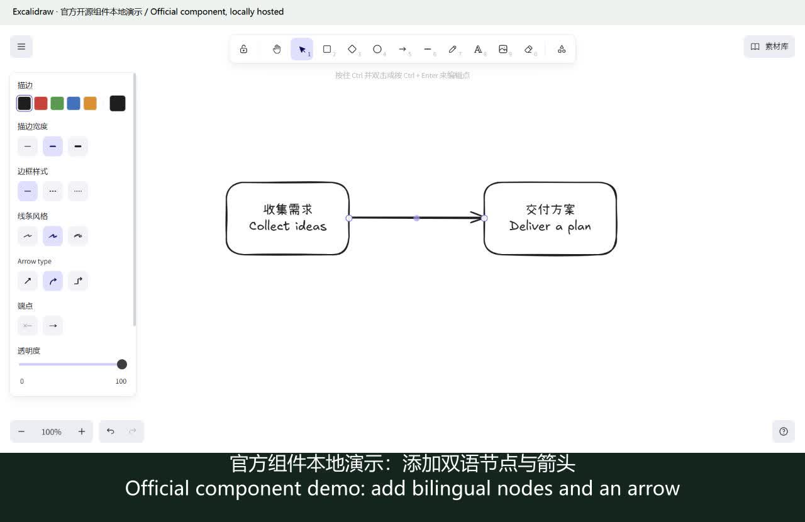
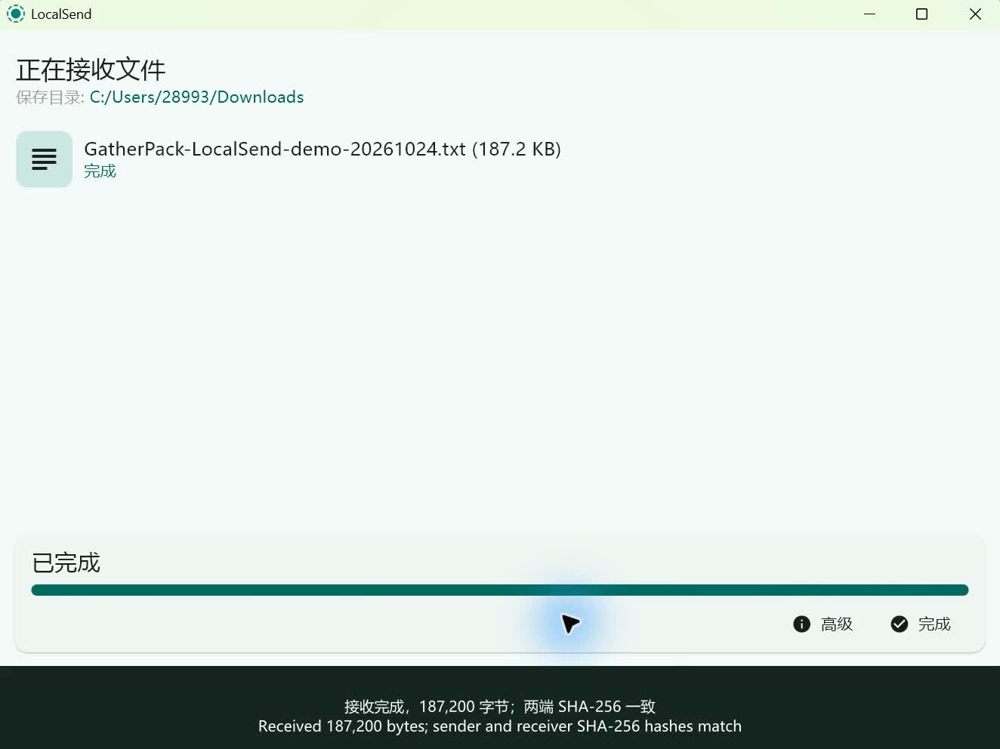
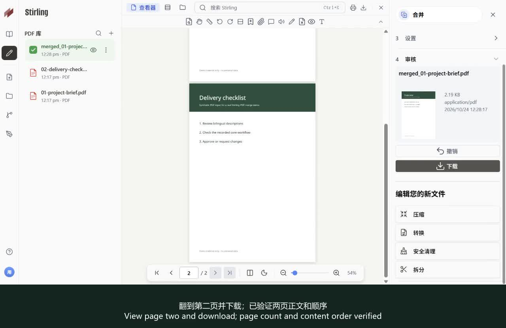
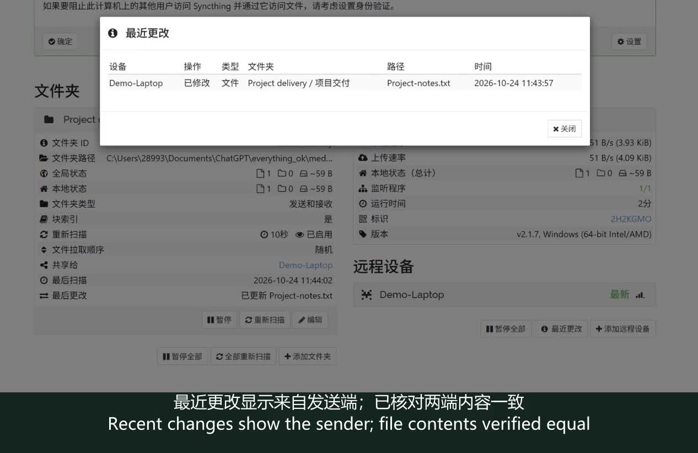
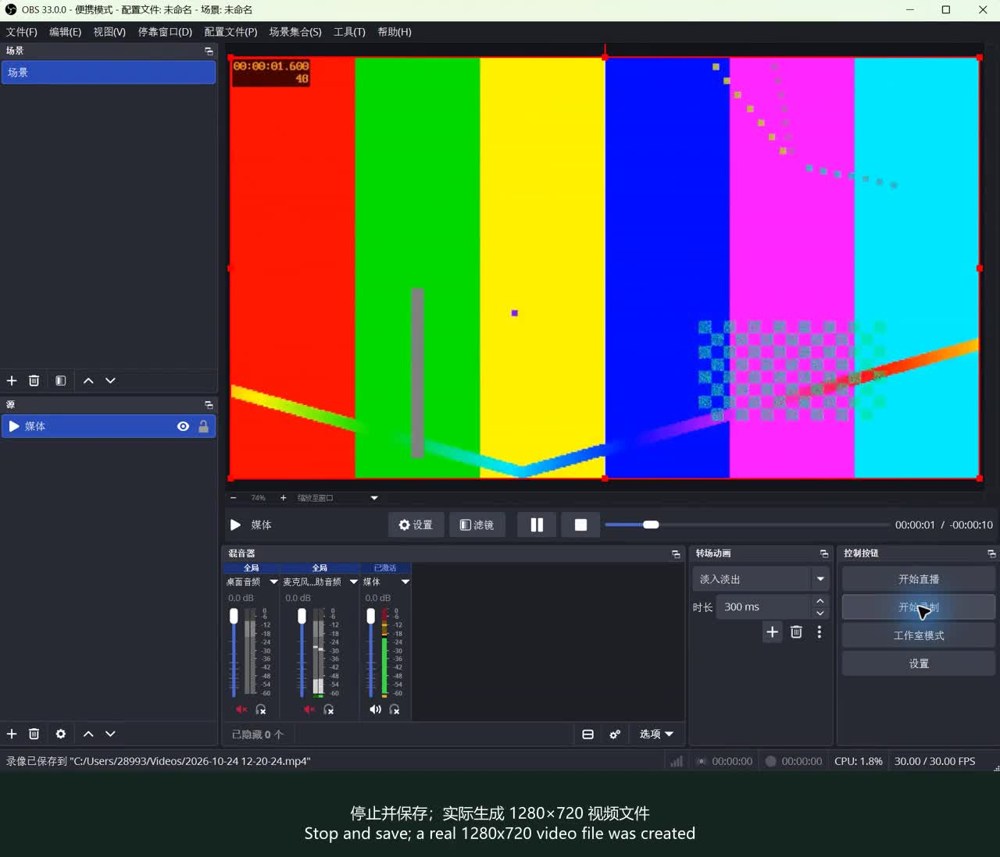
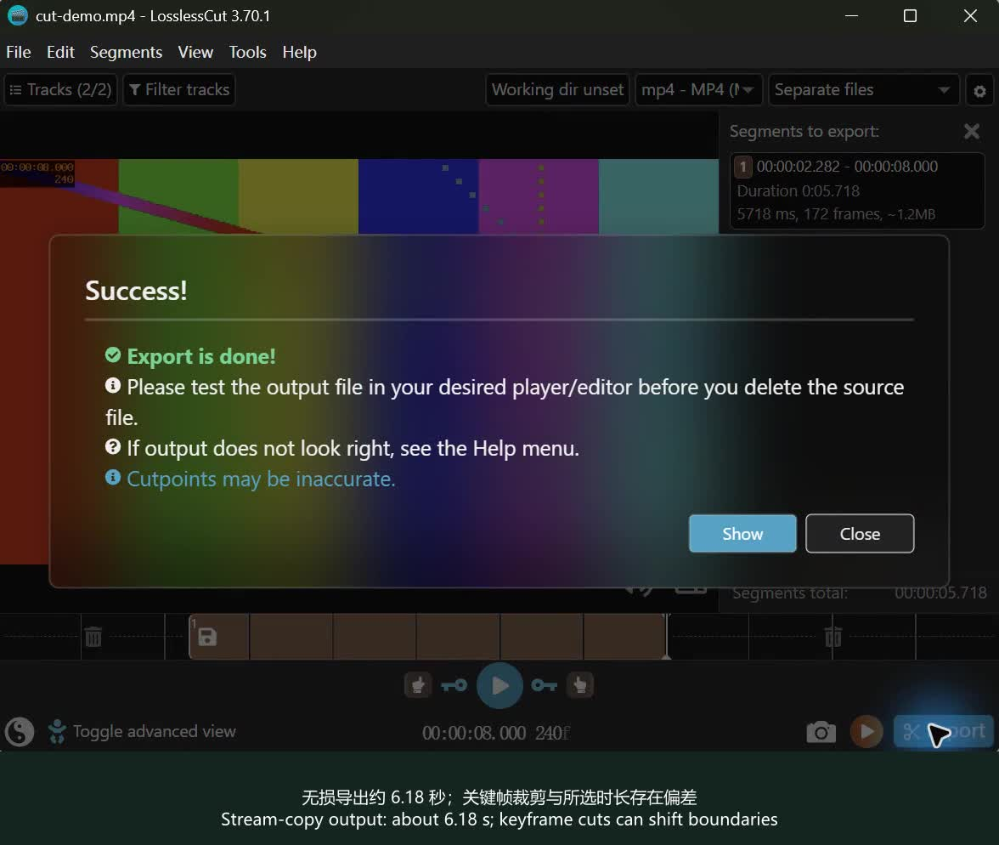
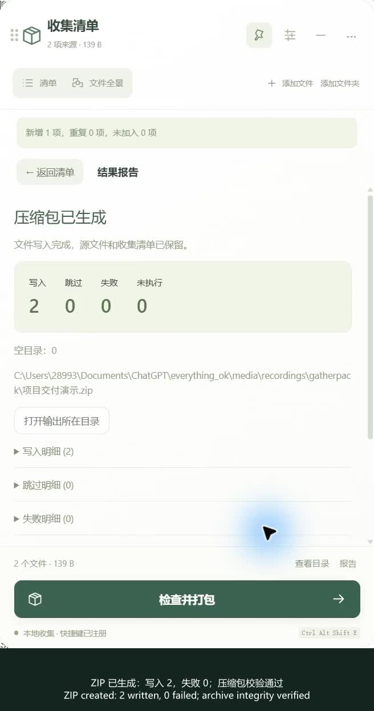
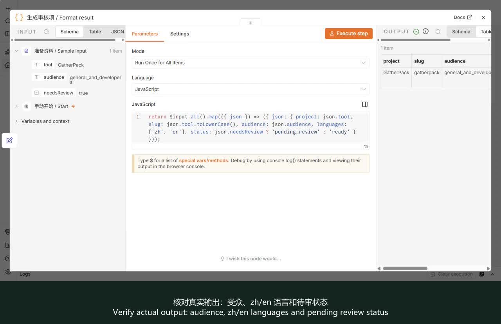
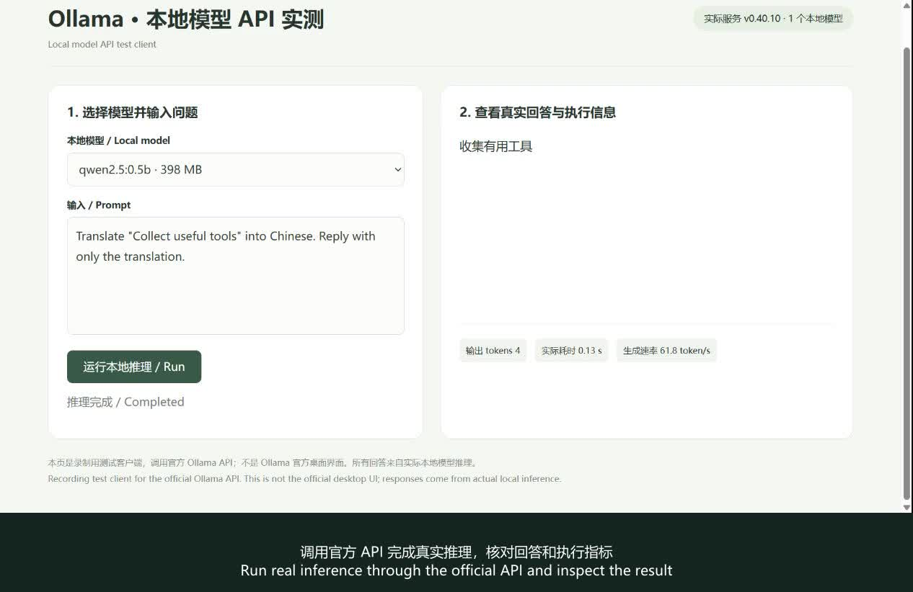
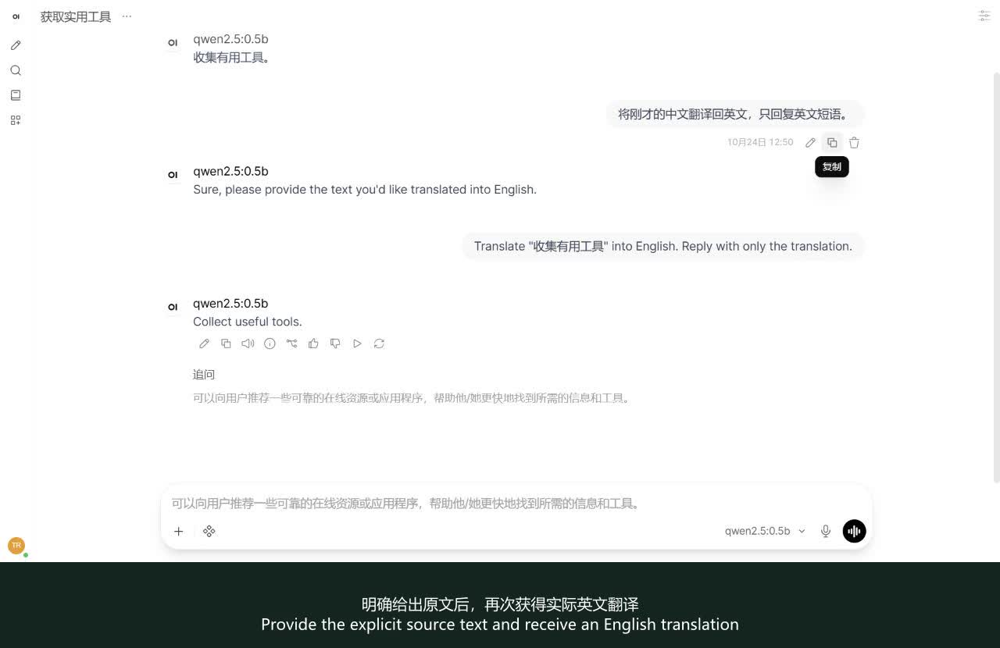

# everything_ok

[English](README.en.md) · [GitHub](https://github.com/dogchenya/everything_ok) · [在线演示](https://dogchenya.github.io/everything_ok/)

搜集好用的 GitHub 工具，让普通用户和开发者先看懂、再上手。首批 **17 个已审核项目**，包含中英文简介、使用门槛和演示。

**打开演示网页：**下载或克隆仓库后，用浏览器打开 [index.html](index.html)，即可直接播放视频和 GIF；无需安装依赖。GitHub 文件页只显示 HTML 源码。

9 段完整核心流程录屏、1 段部分流程录屏、2 个步骤 GIF、5 份上游演示素材。自行录制视频默认 2–3 倍速，保留关键操作和结果，并提供原速版。Excalidraw 已通过人工审核，但文件导出仍未验证，单独标注。

星标数据核对日期：2026-10-24。新增精选项目在核对时超过 50,000 星；保留已通过审核的其他项目。GatherPack 为指定收录的自有项目，单独标识。星标不是质量保证。

| 项目 | ★ | 用途 | 使用门槛 | 演示 |
| --- | ---: | --- | --- | --- |
| [Excalidraw](https://github.com/excalidraw/excalidraw) | 134,441 | 手绘风格白板，快速解释流程与想法 | 网页打开即可；团队增值服务另计 | [部分流程视频](#excalidraw) |
| [LocalSend](https://github.com/localsend/localsend) | 95,358 | 跨设备局域网传文件 | 下载安装；设备需能互相访问 | [实际操作视频](#localsend) |
| [Stirling PDF](https://github.com/Stirling-Tools/Stirling-PDF) | 94,822 | 合并、拆分、转换和处理 PDF | 桌面或自部署；区分社区功能与付费方案 | [实际操作视频](#stirling-pdf) |
| [Syncthing](https://github.com/syncthing/syncthing) | 89,671 | 让多台设备上的文件夹自动保持同步 | 两端安装并配对，需要配置同步目录 | [实际操作视频](#syncthing) |
| [OBS Studio](https://github.com/obsproject/obs-studio) | 77,992 | 录制教程、直播与多画面内容 | 桌面安装；首次需配置画面与音频来源 | [实际操作视频](#obs-studio) |
| [LosslessCut](https://github.com/mifi/lossless-cut) | 45,112 | 快速无损裁剪音视频 | 桌面安装；学习剪切区间与格式限制 | [实际操作视频](#losslesscut) |
| [GatherPack](https://github.com/dogchenya/GatherPack)（自有项目） | 0 | 跨目录收集文件，一次打包带走 | 桌面安装；Alpha 阶段，查看平台验证限制 | [实际操作视频](#gatherpack) |
| [PowerToys](https://github.com/microsoft/PowerToys) | 139,688 | Windows 效率工具集 | Windows；安装后启用所需功能 | [上游素材](#powertoys) |
| [Upscayl](https://github.com/upscayl/upscayl) | 50,922 | 用 AI 放大图片 | 桌面安装；需兼容的显卡环境 | [上游素材](#upscayl) |
| [ScreenToGif](https://github.com/NickeManarin/ScreenToGif) | 27,841 | 录屏并编辑 GIF | Windows；注意 .NET 运行库要求 | [上游素材](#screentogif) |
| [Flow Launcher](https://github.com/Flow-Launcher/Flow.Launcher) | 15,855 | 搜索文件、快速启动应用 | Windows 桌面安装 | [上游素材](#flow-launcher) |
| [PairDrop](https://github.com/schlagmichdoch/PairDrop) | 11,663 | 浏览器跨设备传文件 | 网页即用；自部署需服务器环境 | [上游素材](#pairdrop) |
| [n8n](https://github.com/n8n-io/n8n) | 208,428 | 把重复的跨应用操作串成自动化流程 | 需自部署或云账号；第三方集成可能需要授权、付费 | [实际操作视频](#n8n) |
| [Ollama](https://github.com/ollama/ollama) | 184,505 | 在自己的电脑上运行和使用开放模型 | 安装后下载模型，需足够内存和磁盘；云模型另计 | [实际操作视频](#ollama) |
| [Open WebUI](https://github.com/open-webui/open-webui) | 156,595 | 用统一界面与本地或 API 模型对话 | 需部署，并连接 Ollama 或兼容 API；不自带免费模型算力 | [实际操作视频](#open-webui) |
| [Immich](https://github.com/immich-app/immich) | 117,038 | 搭建自己的照片管理服务 | 需要服务器、Docker、存储维护 | [步骤 GIF](#immich) |
| [Hoppscotch](https://github.com/hoppscotch/hoppscotch) | 80,677 | 发送请求并调试 API | 需要 API 基础；部分连接需额外配置 | [步骤 GIF](#hoppscotch) |

## 看演示

### [Excalidraw](https://github.com/excalidraw/excalidraw)

手绘风格白板，快速解释流程与想法。 网页打开即可；团队增值服务另计

[播放视频](media/excalidraw-demo.mp4) · 2× · 14.2 s · [原速版](media/normal-speed/excalidraw-demo.mp4)

官方 npm 开源组件 0.18.1 本地演示：双语流程节点、连接箭头及完整图导出预览；实际屏幕采集经剪辑。PNG 保存未验证成功，不能计为导出实测完成 / Official component hosted locally; actual drawing and export-preview footage. PNG file saving remains unverified.

### [LocalSend](https://github.com/localsend/localsend)

跨设备局域网传文件。 下载安装；设备需能互相访问

[播放视频](media/localsend-demo.mp4) · 2× · 12.5 s · [原速版](media/normal-speed/localsend-demo.mp4)

官方 LocalSend 1.18.2 实际接收录屏：确认发送方 → 接受 → 传输进度 → 完成；187,200 字节，接收文件 SHA-256 与发送端一致。同一台电脑上的协议测试端发送，不是两台实体设备，未录官方发送端 UI / Actual official-app receiving workflow. An isolated protocol client sends on the same computer; no second physical device or official sending UI is claimed. Received bytes verified equal.

### [Stirling PDF](https://github.com/Stirling-Tools/Stirling-PDF)

合并、拆分、转换和处理 PDF。 桌面或自部署；区分社区功能与付费方案

[播放视频](media/stirling-pdf-demo.mp4) · 2× · 16.3 s · [原速版](media/normal-speed/stirling-pdf-demo.mp4)

官方 Stirling PDF 3.2.1 本地部署：导入两份单页 PDF → 合并 → 翻页 → 下载。已核对结果为 2 页，正文和顺序正确。Windows 环境补齐官方 JPDFium 1.1.6 平台依赖后实测通过 / Official locally hosted deployment: import, merge, inspect and download. Two pages and content order verified; official Windows native dependency added.

### [Syncthing](https://github.com/syncthing/syncthing)

让多台设备上的文件夹自动保持同步。 两端安装并配对，需要配置同步目录

[播放视频](media/syncthing-demo.mp4) · 2× · 15.1 s · [原速版](media/normal-speed/syncthing-demo.mp4)

本机双实例隔离演示：示例文件写入 → 重新扫描 → 接收端出现文件与最近更改；两端内容一致。实际连续屏幕采集，约 5 帧/秒 / Two isolated local nodes; actual timed screen capture; received contents verified equal.

### [OBS Studio](https://github.com/obsproject/obs-studio)

录制教程、直播与多画面内容。 桌面安装；首次需配置画面与音频来源

[播放视频](media/obs-studio-demo.mp4) · 3× · 21.1 s · [原速版](media/normal-speed/obs-studio-demo.mp4)

官方 OBS 33.0.0 便携版实际操作：添加媒体源 → 导入合成视频 → 循环播放 → 适配画布 → 开始/停止录制 → 保存。确实生成 1280×720、约 15.33 秒的 H.264 视频；本次展示媒体源录制，未展示直播、摄像头或屏幕采集 / Actual official OBS workflow, verified output. Demonstrates media-source recording; streaming, webcam and display capture are not demonstrated.

### [LosslessCut](https://github.com/mifi/lossless-cut)

快速无损裁剪音视频。 桌面安装；学习剪切区间与格式限制

[播放视频](media/losslesscut-demo.mp4) · 2× · 20.5 s · [原速版](media/normal-speed/losslesscut-demo.mp4)

官方 LosslessCut 3.70.1 实际录屏：12 秒合成片 → 标记 2.282–8.000 秒区间 → MP4 导出 → 成功。实际输出约 6.18 秒；关键帧裁剪存在边界偏差。183 个导出视频压缩数据包均与源片连续片段完全一致，已验证视频未重编码 / Actual editing/export workflow. Output ~6.18 s; keyframe cuts shift boundaries. All 183 compressed video packets match an input subsequence; no video re-encoding.

### [GatherPack](https://github.com/dogchenya/GatherPack)

跨目录收集文件，一次打包带走。 桌面安装；Alpha 阶段，查看平台验证限制

[播放视频](media/gatherpack-demo.mp4) · 2× · 25.5 s · [原速版](media/normal-speed/gatherpack-demo.mp4)

两个目录添加文件 → 检查目录 → ZIP 打包 → 写入 2、失败 0；真实录屏经剪辑，ZIP 完整性校验通过 / Edited actual recording; two files collected and ZIP integrity verified.

### [PowerToys](https://github.com/microsoft/PowerToys)

Windows 效率工具集。 Windows；安装后启用所需功能

[上游演示视频](https://github.com/microsoft/PowerToys/blob/main/src/settings-ui/Settings.UI/Assets/Settings/Modules/OOBE/FancyZones.mp4)

上游 FancyZones 功能视频 / Upstream FancyZones video

### [Upscayl](https://github.com/upscayl/upscayl)

用 AI 放大图片。 桌面安装；需兼容的显卡环境

[上游演示视频](https://github.com/upscayl/upscayl/blob/main/upscayl.mp4)

上游视频 / Upstream video

### [ScreenToGif](https://github.com/NickeManarin/ScreenToGif)

录屏并编辑 GIF。 Windows；注意 .NET 运行库要求

[演示来源](https://nickemanarin.github.io/ScreenToGif-Website/media/Editor.gif)

上游编辑器 GIF / Upstream editor GIF

### [Flow Launcher](https://github.com/Flow-Launcher/Flow.Launcher)

搜索文件、快速启动应用。 Windows 桌面安装

[演示来源](https://user-images.githubusercontent.com/6903107/207167068-2196d2a3-2caa-4856-958b-a780fbda95c6.gif)

上游 README 中的 GIF / GIF linked in upstream README

### [PairDrop](https://github.com/schlagmichdoch/PairDrop)

浏览器跨设备传文件。 网页即用；自部署需服务器环境

[演示来源](https://github.com/schlagmichdoch/PairDrop/blob/master/docs/pairdrop_screenshot_mobile.gif)

上游 GIF / Upstream GIF

### [n8n](https://github.com/n8n-io/n8n)

把重复的跨应用操作串成自动化流程。 需自部署或云账号；第三方集成可能需要授权、付费

[播放视频](media/n8n-demo.mp4) · 3× · 20.0 s · [原速版](media/normal-speed/n8n-demo.mp4)

官方 n8n 2.44.6 本地隔离实例：导入三节点模板 → 查看并修改输入参数 → 执行 → 核对真实输出。三个节点均成功；修改后的受众、zh/en 语言标记和 pending_review 状态已在输出表格核对。不使用外部账号、API 或模型；演示数据不修改主站人工审核记录 / Actual local execution with three successful nodes and verified output. No external credentials or models; demo output does not modify the catalog human reviews.

### [Ollama](https://github.com/ollama/ollama)

在自己的电脑上运行和使用开放模型。 安装后下载模型，需足够内存和磁盘；云模型另计

[播放视频](media/ollama-demo.mp4) · 2× · 10.7 s · [原速版](media/normal-speed/ollama-demo.mp4)

官方 Ollama 0.40.10 CPU 服务和 qwen2.5:0.5b：选择已下载模型 → 输入翻译问题 → 实际流式推理 → 核对回答与耗时。画面是明确标注的 API 测试客户端，并非 Ollama 官方桌面界面；输出来自真实本地模型。只验证此问答流程，未覆盖其他模型、工具调用或部署功能 / Real local inference via a labelled API test client, not the official desktop UI. Only this prompt workflow is verified.

### [Open WebUI](https://github.com/open-webui/open-webui)

用统一界面与本地或 API 模型对话。 需部署，并连接 Ollama 或兼容 API；不自带免费模型算力

[播放视频](media/open-webui-demo.mp4) · 3× · 19.3 s · [原速版](media/normal-speed/open-webui-demo.mp4)

官方 Open WebUI 0.12.3 本地隔离部署（官方 slim 依赖，保留登录认证），连接实际 Ollama / qwen2.5:0.5b：输入问题 → 中文翻译 → 追问 → 明确原文重试 → 英文翻译 → 刷新核对三轮历史。保留小模型未理解上下文追问的真实失误，未声称已验证知识库、语音或工具调用 / Actual official UI and model responses, including a failed implicit follow-up and successful explicit retry; all three turns survive reload. Knowledge, voice and tool calling are not verified.

### [Immich](https://github.com/immich-app/immich)

搭建自己的照片管理服务。 需要服务器、Docker、存储维护

[演示来源](media/immich-demo.gif)

官方公开演示账号；照片时间线→相册。实例禁用上传，未演示上传 / Official public demo account; timeline to albums. Uploads are disabled and not demonstrated

### [Hoppscotch](https://github.com/hoppscotch/hoppscotch)

发送请求并调试 API。 需要 API 基础；部分连接需额外配置

[演示来源](media/hoppscotch-demo.gif)

官方在线实例；公开 echo 接口 GET→200 OK / Official hosted app; public echo GET request to 200 OK

## 费用、许可与素材

部分工具需要服务器、模型服务或付费 API，源代码可见不代表全部功能免费。n8n、Open WebUI 等项目有专门许可条款，请以各项目当前说明为准。上游演示保留原链接，不把代码许可证推定为所有素材的转载授权。

[素材与实测说明](docs/MEDIA.md) · [收录规范](CONTRIBUTING.md)

## 维护与本地审核

`node scripts/build.mjs` 从目录数据生成中英文 README 和演示网页。

`node review/server.mjs` 启动本地审核台： http://127.0.0.1:43121/

审核备注与原始采集资料仅保留在本机；当前发布清单排除没有完成补录的 AppFlowy、RustDesk、Dify。
