# everything_ok

[English](README.en.md) · [演示网页](https://dogchenya.github.io/everything_ok/)

实用 GitHub 工具合集，按用途分类，附简介、使用门槛和 GIF 演示。

[文件分享与整理](#file-sharing) · [文档与日常效率](#office) · [图像、录屏与视频](#media-tools) · [AI 与本地模型](#ai-tools) · [开发与自动化](#developer-tools) · [照片管理](#photos)

## 文件分享与整理

<table>
<thead><tr><th>工具</th><th>用途与上手门槛</th><th>GIF 演示</th></tr></thead>
<tbody>
<tr>
<td width="120" valign="top"><strong><a href="https://github.com/localsend/localsend">LocalSend</a></strong> ★ 95,358</td>
<td width="260" valign="top"><strong>跨设备局域网传文件</strong>  上手：下载安装；设备需能互相访问

演示范围
接受文件 → 接收完成。发送端是本机协议测试客户端，未展示两台实体设备互传。
</td>
<td width="420" valign="top"><a href="https://dogchenya.github.io/everything_ok/media/localsend-demo.mp4">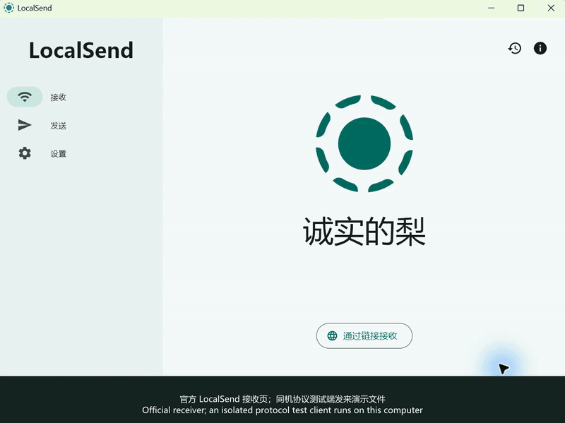</a> <a href="https://dogchenya.github.io/everything_ok/media/localsend-demo.mp4">MP4 视频</a> · 2× · 12.5 s</td>
</tr>
<tr>
<td width="120" valign="top"><strong><a href="https://github.com/schlagmichdoch/PairDrop">PairDrop</a></strong> ★ 11,663</td>
<td width="260" valign="top"><strong>浏览器跨设备传文件</strong>  上手：网页即用；自部署需服务器环境

演示范围
演示由上游项目提供。
</td>
<td width="420" valign="top"> <a href="https://github.com/schlagmichdoch/PairDrop/blob/master/docs/pairdrop_screenshot_mobile.gif">上游 GIF</a></td>
</tr>
<tr>
<td width="120" valign="top"><strong><a href="https://github.com/dogchenya/GatherPack">GatherPack</a></strong> ★ 0 自有项目</td>
<td width="260" valign="top"><strong>跨目录收集文件，一次打包带走</strong>  上手：桌面安装；Alpha 阶段，查看平台验证限制

演示范围
从两个目录收集文件 → 检查目录 → ZIP 打包；写入 2 个文件，失败 0。
</td>
<td width="420" valign="top"><a href="https://dogchenya.github.io/everything_ok/media/gatherpack-demo.mp4">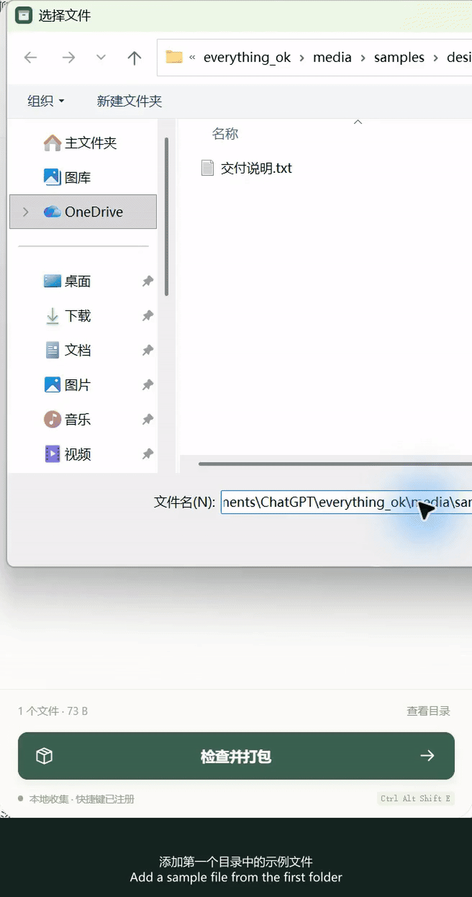</a> <a href="https://dogchenya.github.io/everything_ok/media/gatherpack-demo.mp4">MP4 视频</a> · 2× · 25.5 s</td>
</tr>
<tr>
<td width="120" valign="top"><strong><a href="https://github.com/syncthing/syncthing">Syncthing</a></strong> ★ 89,671</td>
<td width="260" valign="top"><strong>让多台设备上的文件夹自动保持同步</strong>  上手：两端安装并配对，需要配置同步目录

演示范围
本机两个隔离实例：写入文件 → 同步 → 接收端核对内容。
</td>
<td width="420" valign="top"><a href="https://dogchenya.github.io/everything_ok/media/syncthing-demo.mp4">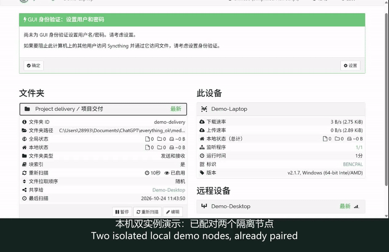</a> <a href="https://dogchenya.github.io/everything_ok/media/syncthing-demo.mp4">MP4 视频</a> · 2× · 15.1 s</td>
</tr>
<tr>
<td width="120" valign="top"><strong><a href="https://github.com/files-community/Files">Files</a></strong> ★ 46,178</td>
<td width="260" valign="top"><strong>Windows 文件管理器：多标签、双栏和列视图</strong>  上手：Windows 安装；商店版付费，另有官网安装包

演示范围
官方列视图 GIF：逐层浏览文件夹；未展示双栏、压缩包编辑或本轮安装实测。
</td>
<td width="420" valign="top"> <a href="https://raw.githubusercontent.com/files-community/Website/main/static/blog-resources/v4/Columns.gif">上游 GIF</a></td>
</tr>
</tbody>
</table>

## 文档与日常效率

<table>
<thead><tr><th>工具</th><th>用途与上手门槛</th><th>GIF 演示</th></tr></thead>
<tbody>
<tr>
<td width="120" valign="top"><strong><a href="https://github.com/Stirling-Tools/Stirling-PDF">Stirling PDF</a></strong> ★ 94,822</td>
<td width="260" valign="top"><strong>合并、拆分、转换和处理 PDF</strong>  上手：桌面或自部署；区分社区功能与付费方案；部分 Office 转换需要云端或服务端支持，需逐项核对

演示范围
导入两份 PDF → 合并 → 翻页检查 → 下载，结果页数与顺序已核对。
</td>
<td width="420" valign="top"><a href="https://dogchenya.github.io/everything_ok/media/stirling-pdf-demo.mp4">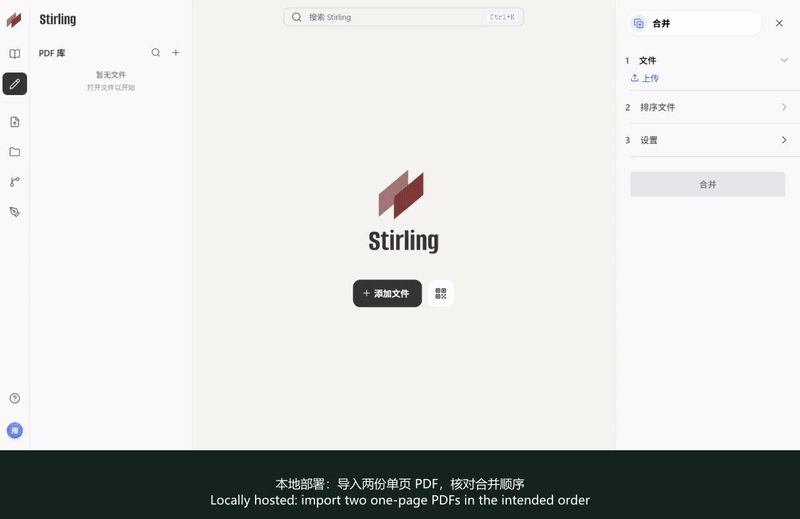</a> <a href="https://dogchenya.github.io/everything_ok/media/stirling-pdf-demo.mp4">MP4 视频</a> · 2× · 16.3 s</td>
</tr>
<tr>
<td width="120" valign="top"><strong><a href="https://github.com/excalidraw/excalidraw">Excalidraw</a></strong> ★ 134,441</td>
<td width="260" valign="top"><strong>手绘风格白板，快速解释流程与想法</strong>  上手：网页打开即可；团队增值服务另计  <strong>部分流程 · 导出未验证</strong>

演示范围
绘制双语流程图 → 导出预览。文件导出尚未验证，本项为部分流程。
</td>
<td width="420" valign="top"><a href="https://dogchenya.github.io/everything_ok/media/excalidraw-demo.mp4">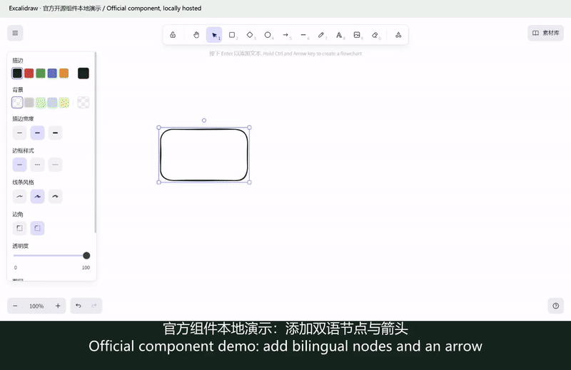</a> <a href="https://dogchenya.github.io/everything_ok/media/excalidraw-demo.mp4">MP4 视频</a> · 2× · 14.2 s</td>
</tr>
<tr>
<td width="120" valign="top"><strong><a href="https://github.com/microsoft/PowerToys">PowerToys</a></strong> ★ 139,688</td>
<td width="260" valign="top"><strong>Windows 效率工具集</strong>  上手：Windows；安装后启用所需功能

演示范围
演示由上游项目提供。
</td>
<td width="420" valign="top"><a href="https://raw.githubusercontent.com/microsoft/PowerToys/main/src/settings-ui/Settings.UI/Assets/Settings/Modules/OOBE/FancyZones.mp4">▶ 上游演示视频</a></td>
</tr>
<tr>
<td width="120" valign="top"><strong><a href="https://github.com/Flow-Launcher/Flow.Launcher">Flow Launcher</a></strong> ★ 15,855</td>
<td width="260" valign="top"><strong>搜索文件、快速启动应用</strong>  上手：Windows 桌面安装

演示范围
演示由上游项目提供。
</td>
<td width="420" valign="top"> <a href="https://user-images.githubusercontent.com/6903107/207167068-2196d2a3-2caa-4856-958b-a780fbda95c6.gif">上游 GIF</a></td>
</tr>
<tr>
<td width="120" valign="top"><strong><a href="https://github.com/laurent22/joplin">Joplin</a></strong> ★ 56,852</td>
<td width="260" valign="top"><strong>离线记笔记、待办和整理资料</strong>  上手：桌面或手机安装；云同步方案另选，Joplin Cloud 收费

演示范围
官方短视频仅展示笔记内已有绘图的编辑；笔记创建、导入和同步未做本轮实测。
</td>
<td width="420" valign="top"><a href="https://raw.githubusercontent.com/laurent22/joplin/dev/Assets/WebsiteAssets/images/draw/edit-existing-drawing-on-desktop.mp4">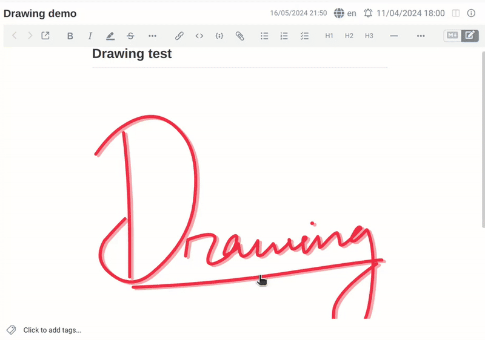</a> <a href="https://raw.githubusercontent.com/laurent22/joplin/dev/Assets/WebsiteAssets/images/draw/edit-existing-drawing-on-desktop.mp4">上游视频</a> · 8.3 s</td>
</tr>
<tr>
<td width="120" valign="top"><strong><a href="https://github.com/siyuan-note/siyuan">思源笔记 / SiYuan</a></strong> ★ 46,905</td>
<td width="260" valign="top"><strong>本地优先的 Markdown 笔记，支持块引用</strong>  上手：桌面安装；同步及部分服务付费

演示范围
官方内置指南视频展示列表与格式编辑；块引用、同步、AI 未在这段素材中演示，非本轮实测。
</td>
<td width="420" valign="top"><a href="https://raw.githubusercontent.com/siyuan-note/siyuan/master/app/guide/20210808180117-6v0mkxr/assets/formatting_elements-20210607225733-o1keasx.mp4">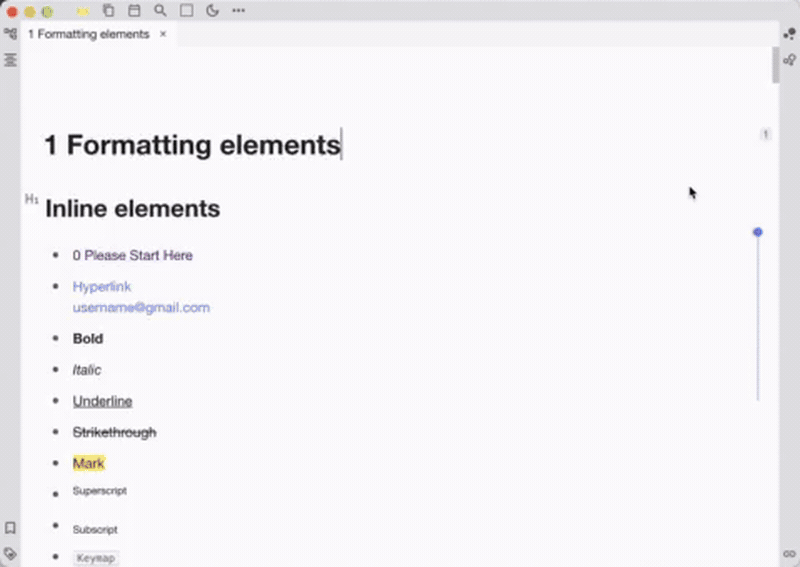</a> <a href="https://raw.githubusercontent.com/siyuan-note/siyuan/master/app/guide/20210808180117-6v0mkxr/assets/formatting_elements-20210607225733-o1keasx.mp4">上游视频</a> · 9.6 s</td>
</tr>
<tr>
<td width="120" valign="top"><strong><a href="https://github.com/hiroi-sora/Umi-OCR">Umi-OCR</a></strong> ★ 48,143</td>
<td width="260" valign="top"><strong>把截图和扫描图片转成可复制文字，支持离线批量识别</strong>  上手：Windows 解压即用；Linux 另有版本。本次仅验证 Windows Rapid v2.1.5 图片识别

演示范围
导入图片 → 离线识别 → 查看文字；日期、编号、金额核对正确，部分段落合并。仅测试印刷体图片。
</td>
<td width="420" valign="top"><a href="https://dogchenya.github.io/everything_ok/media/umi-ocr-demo.mp4">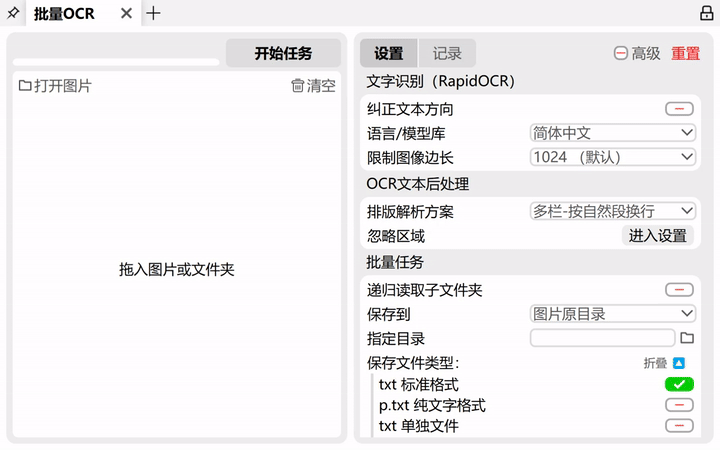</a> <a href="https://dogchenya.github.io/everything_ok/media/umi-ocr-demo.mp4">MP4 视频</a> · 2× · 12.7 s</td>
</tr>
<tr>
<td width="120" valign="top"><strong><a href="https://github.com/PDFMathTranslate/PDFMathTranslate">PDFMathTranslate</a></strong> ★ 37,812</td>
<td width="260" valign="top"><strong>翻译外文 PDF，尽量保留公式、图表和原有版式</strong>  上手：可用官方推荐的在线服务；本地版需安装，部分翻译服务需密钥或收费。文件处理位置取决于部署和翻译服务

演示范围
官方旧版 GUI：导入 PDF → 翻译 → 查看中文结果和双语下载入口。未做本轮翻译实测，当前界面可能不同。
</td>
<td width="420" valign="top"> <a href="https://raw.githubusercontent.com/PDFMathTranslate/PDFMathTranslate/main/docs/images/gui.gif">上游 GIF</a></td>
</tr>
</tbody>
</table>

## 图像、录屏与视频

<table>
<thead><tr><th>工具</th><th>用途与上手门槛</th><th>GIF 演示</th></tr></thead>
<tbody>
<tr>
<td width="120" valign="top"><strong><a href="https://github.com/mifi/lossless-cut">LosslessCut</a></strong> ★ 45,112</td>
<td width="260" valign="top"><strong>快速无损裁剪音视频</strong>  上手：桌面安装；学习剪切区间与格式限制

演示范围
导入视频 → 选取区间 → 无损导出。关键帧裁剪会造成时间边界偏差。
</td>
<td width="420" valign="top"><a href="https://dogchenya.github.io/everything_ok/media/losslesscut-demo.mp4">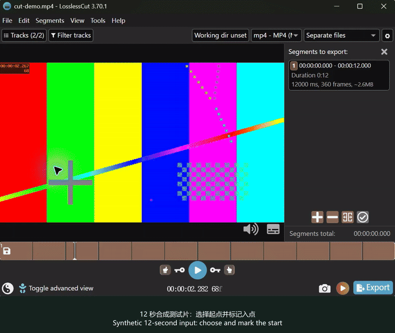</a> <a href="https://dogchenya.github.io/everything_ok/media/losslesscut-demo.mp4">MP4 视频</a> · 2× · 20.5 s</td>
</tr>
<tr>
<td width="120" valign="top"><strong><a href="https://github.com/NickeManarin/ScreenToGif">ScreenToGif</a></strong> ★ 27,841</td>
<td width="260" valign="top"><strong>录屏并编辑 GIF</strong>  上手：Windows；注意 .NET 运行库要求

演示范围
演示由上游项目提供。
</td>
<td width="420" valign="top"> <a href="https://nickemanarin.github.io/ScreenToGif-Website/media/Editor.gif">上游 GIF</a></td>
</tr>
<tr>
<td width="120" valign="top"><strong><a href="https://github.com/obsproject/obs-studio">OBS Studio</a></strong> ★ 77,992</td>
<td width="260" valign="top"><strong>录制教程、直播与多画面内容</strong>  上手：桌面安装；首次需配置画面与音频来源

演示范围
添加媒体源 → 适配画布 → 开始与停止录制 → 保存视频。
</td>
<td width="420" valign="top"><a href="https://dogchenya.github.io/everything_ok/media/obs-studio-demo.mp4">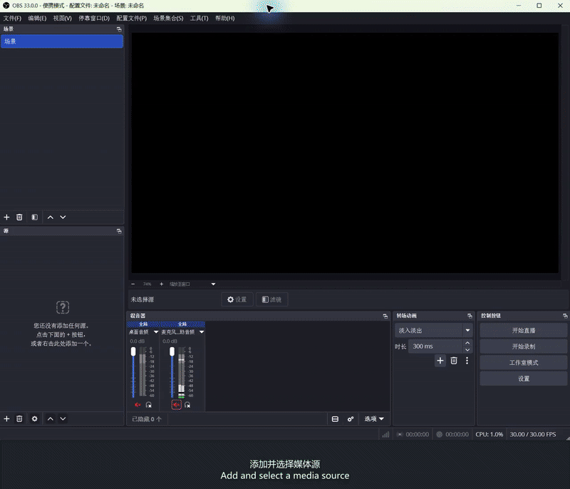</a> <a href="https://dogchenya.github.io/everything_ok/media/obs-studio-demo.mp4">MP4 视频</a> · 3× · 21.1 s</td>
</tr>
<tr>
<td width="120" valign="top"><strong><a href="https://github.com/upscayl/upscayl">Upscayl</a></strong> ★ 50,922</td>
<td width="260" valign="top"><strong>用 AI 放大图片</strong>  上手：桌面安装；需兼容的显卡环境

演示范围
演示由上游项目提供。
</td>
<td width="420" valign="top"><a href="https://raw.githubusercontent.com/upscayl/upscayl/main/upscayl.mp4">▶ 上游演示视频</a></td>
</tr>
</tbody>
</table>

## AI 与本地模型

<table>
<thead><tr><th>工具</th><th>用途与上手门槛</th><th>GIF 演示</th></tr></thead>
<tbody>
<tr>
<td width="120" valign="top"><strong><a href="https://github.com/open-webui/open-webui">Open WebUI</a></strong> ★ 156,595</td>
<td width="260" valign="top"><strong>用统一界面与本地或 API 模型对话</strong>  上手：需部署，并连接 Ollama 或兼容 API；不自带免费模型算力

演示范围
连接本地模型 → 问答与重试 → 刷新后保留历史。保留了小模型未理解上下文追问的失误。
</td>
<td width="420" valign="top"><a href="https://dogchenya.github.io/everything_ok/media/open-webui-demo.mp4">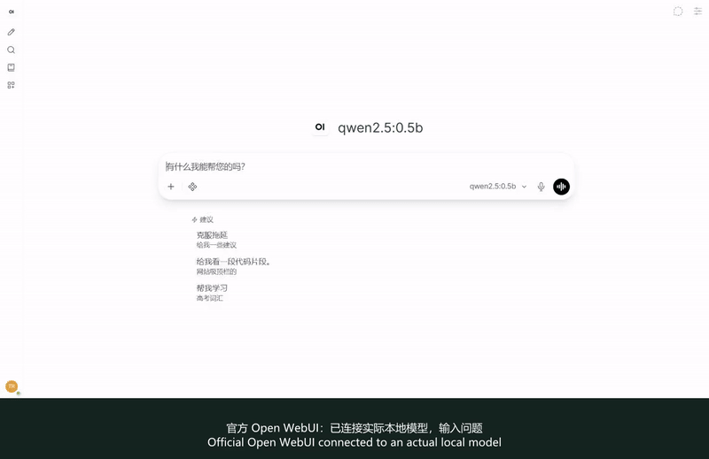</a> <a href="https://dogchenya.github.io/everything_ok/media/open-webui-demo.mp4">MP4 视频</a> · 3× · 19.3 s</td>
</tr>
<tr>
<td width="120" valign="top"><strong><a href="https://github.com/ollama/ollama">Ollama</a></strong> ★ 184,505</td>
<td width="260" valign="top"><strong>在自己的电脑上运行和使用开放模型</strong>  上手：安装后下载模型，需足够内存和磁盘；云模型另计

演示范围
本地模型翻译与执行指标。画面是录制用 API 测试客户端，非官方桌面界面。
</td>
<td width="420" valign="top"><a href="https://dogchenya.github.io/everything_ok/media/ollama-demo.mp4">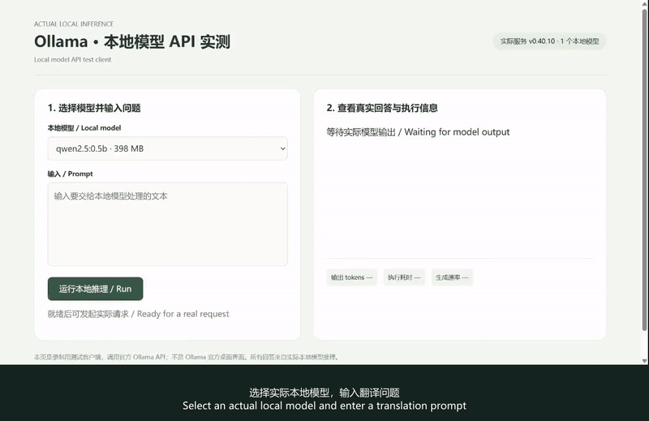</a> <a href="https://dogchenya.github.io/everything_ok/media/ollama-demo.mp4">MP4 视频</a> · 2× · 10.7 s</td>
</tr>
</tbody>
</table>

## 开发与自动化

<table>
<thead><tr><th>工具</th><th>用途与上手门槛</th><th>GIF 演示</th></tr></thead>
<tbody>
<tr>
<td width="120" valign="top"><strong><a href="https://github.com/hoppscotch/hoppscotch">Hoppscotch</a></strong> ★ 80,677</td>
<td width="260" valign="top"><strong>发送请求并调试 API</strong>  上手：需要 API 基础；部分连接需额外配置  <strong>步骤 GIF</strong>

演示范围
发送 GET 请求 → 查看 200 OK 响应。此处为步骤 GIF。
</td>
<td width="420" valign="top">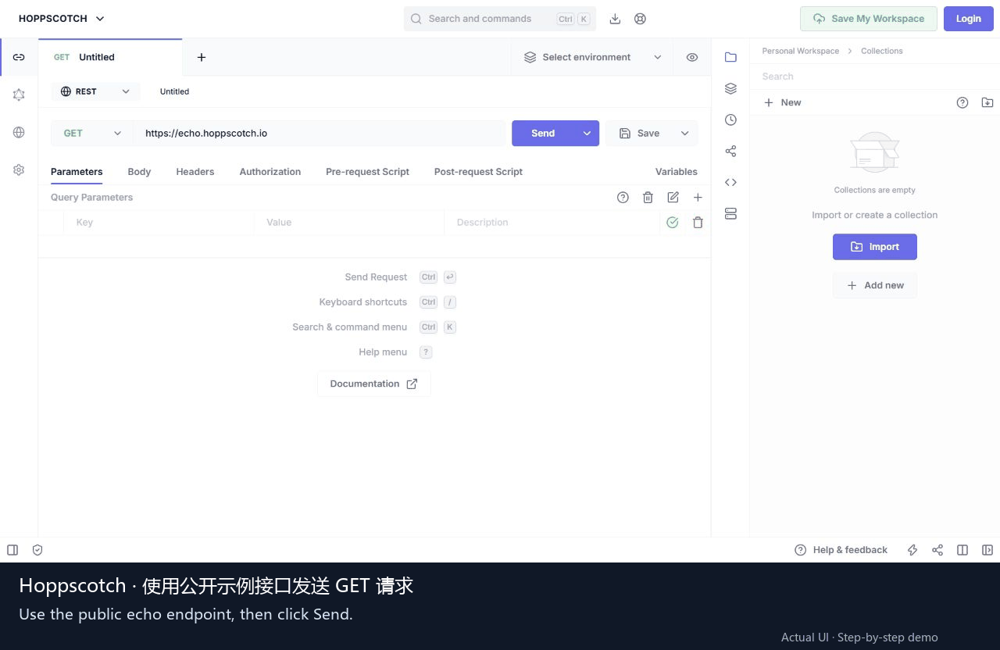 步骤 GIF</td>
</tr>
<tr>
<td width="120" valign="top"><strong><a href="https://github.com/n8n-io/n8n">n8n</a></strong> ★ 208,428</td>
<td width="260" valign="top"><strong>把重复的跨应用操作串成自动化流程</strong>  上手：需自部署或云账号；第三方集成可能需要授权、付费

演示范围
导入三节点模板 → 修改输入 → 执行成功 → 检查输出；不需要外部账号或 API。
</td>
<td width="420" valign="top"><a href="https://dogchenya.github.io/everything_ok/media/n8n-demo.mp4">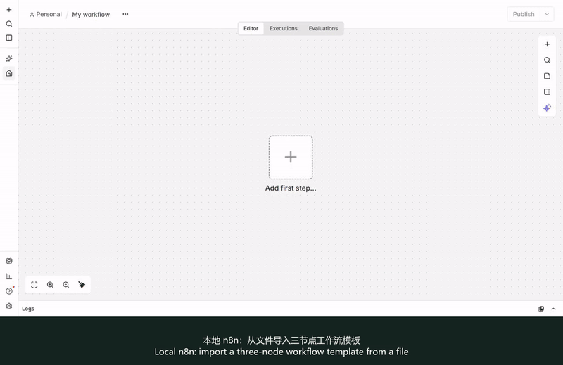</a> <a href="https://dogchenya.github.io/everything_ok/media/n8n-demo.mp4">MP4 视频</a> · 3× · 20.0 s</td>
</tr>
<tr>
<td width="120" valign="top"><strong><a href="https://github.com/junegunn/fzf">fzf</a></strong> ★ 83,751</td>
<td width="260" valign="top"><strong>在终端中模糊搜索文件和命令历史</strong>  上手：命令行安装；需要终端基础

演示范围
项目作者维护的功能 GIF，展示终端中的模糊筛选；素材界面可能与当前版本不同，非本轮实测。
</td>
<td width="420" valign="top"> <a href="https://raw.githubusercontent.com/junegunn/i/master/fzf.gif">上游 GIF</a></td>
</tr>
<tr>
<td width="120" valign="top"><strong><a href="https://github.com/jesseduffield/lazygit">Lazygit</a></strong> ★ 83,396</td>
<td width="260" valign="top"><strong>用终端界面查看改动、暂存和提交 Git 代码</strong>  上手：安装 Git 与 Lazygit；需要 Git 基础

演示范围
上游 README 的 commit_and_push 视频展示暂存、提交与推送；仅观看官方素材，未操作用户仓库。
</td>
<td width="420" valign="top"><a href="https://github.com/user-attachments/assets/031799d1-740d-4cda-90cf-689513fa9860">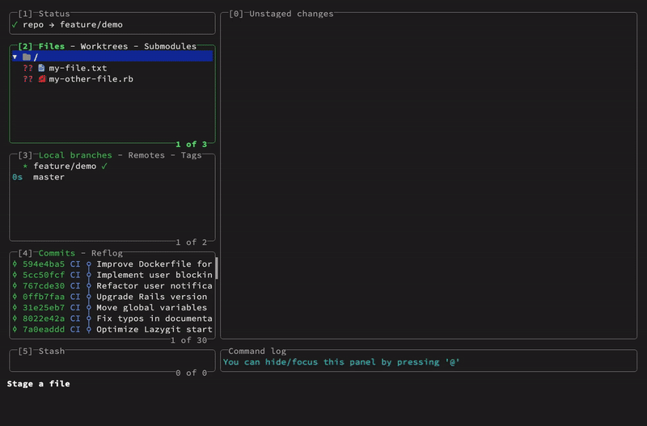</a> <a href="https://github.com/user-attachments/assets/031799d1-740d-4cda-90cf-689513fa9860">上游视频</a> · 11.4 s</td>
</tr>
<tr>
<td width="120" valign="top"><strong><a href="https://github.com/beekeeper-studio/beekeeper-studio">Beekeeper Studio</a></strong> ★ 23,788</td>
<td width="260" valign="top"><strong>用图形界面连接数据库、运行 SQL 和查看数据</strong>  上手：桌面安装；需数据库连接信息，部分功能与数据库支持付费

演示范围
官方仓库提供的数据库客户端 GIF，包含连接与查询界面；不保证素材中的所有功能均属于免费版，未做本轮实测。
</td>
<td width="420" valign="top"> <a href="https://raw.githubusercontent.com/beekeeper-studio/beekeeper-studio/master/apps/studio/screenshots/beekeeper-studio-demo.gif">上游 GIF</a></td>
</tr>
</tbody>
</table>

## 照片管理

<table>
<thead><tr><th>工具</th><th>用途与上手门槛</th><th>GIF 演示</th></tr></thead>
<tbody>
<tr>
<td width="120" valign="top"><strong><a href="https://github.com/immich-app/immich">Immich</a></strong> ★ 117,038</td>
<td width="260" valign="top"><strong>搭建自己的照片管理服务</strong>  上手：需要服务器、Docker、存储维护  <strong>步骤 GIF</strong>

演示范围
官方公开演示：照片时间线 → 相册。步骤 GIF；实例禁用上传，未演示上传。
</td>
<td width="420" valign="top">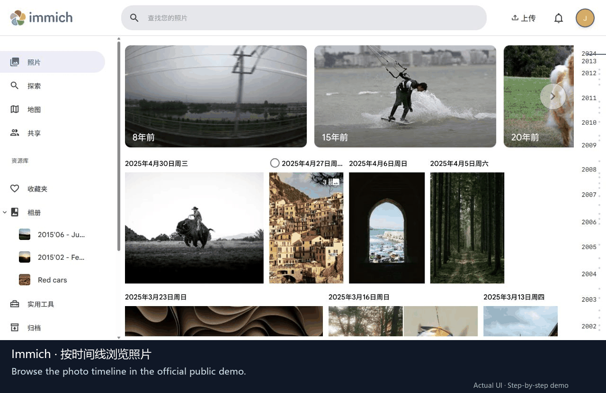 步骤 GIF</td>
</tr>
</tbody>
</table>

## 说明与补充项目

有些项目需要服务器、模型或付费 API，使用前请查看官方许可和费用。星标不代表质量保证；演示仅覆盖所注明的功能。

[演示来源与实测范围](docs/MEDIA.md) · [推荐一个工具](https://github.com/dogchenya/everything_ok/issues/new) · [收录规范与维护](CONTRIBUTING.md)
